<p align="center">
  
</p>

<p align="center">
  
  
  
  
</p>

---

##  Sobre o projeto

**API REST** desenvolvida em **Laravel** para praticar a construção de APIs. Ela gerencia o cadastro de **alunos** e **instrutores**, com **upload de foto**, validação de dados e respostas em JSON.

---

##  Funcionalidades

- CRUD completo de alunos e instrutores via `apiResource`
- Upload de imagem com armazenamento no disco `public`
- Remoção automática da foto antiga ao atualizar o registro
- Atualização parcial com `PATCH`, validando apenas os campos enviados
- Mensagens de validação personalizadas
- Respostas de erro em JSON (`404` para registros inexistentes)

---

##  Endpoints

| Método | Rota | Descrição |
|:---:|:---|:---|
| `GET` | `/api/aluno` | Lista todos os alunos |
| `POST` | `/api/aluno` | Cadastra um aluno (`nome`, `foto`) |
| `GET` | `/api/aluno/{id}` | Exibe um aluno |
| `PUT` / `PATCH` | `/api/aluno/{id}` | Atualiza um aluno (completo ou parcial) |
| `DELETE` | `/api/aluno/{id}` | Remove um aluno |
| `GET` | `/api/instrutor` | Lista todos os instrutores |
| `POST` | `/api/instrutor` | Cadastra um instrutor (`nome`, `foto`) |
| `GET` | `/api/instrutor/{id}` | Exibe um instrutor |
| `PUT` / `PATCH` | `/api/instrutor/{id}` | Atualiza um instrutor (completo ou parcial) |
| `DELETE` | `/api/instrutor/{id}` | Remove um instrutor |

> Envie `POST`, `PUT` e `PATCH` como `multipart/form-data` quando houver foto.

---

##  Como executar

**Pré-requisitos:** PHP 8.0+, Composer e MySQL.

```bash
# Clonar o repositório
git clone https://github.com/GustavoHermogenes/api-learning.git
cd api-learning

# Instalar as dependências
composer install

# Configurar o ambiente
cp .env.example .env
php artisan key:generate
# Ajuste as credenciais do banco de dados no arquivo .env

# Criar as tabelas e o link público das imagens
php artisan migrate
php artisan storage:link

# Iniciar o servidor
php artisan serve
```

A API estará disponível em `http://localhost:8000/api`.

---

##  Autor

<p>
  <b>Gustavo Hermogenes</b> — Desenvolvedor Full Stack<br/><br/>
  <a href="https://github.com/GustavoHermogenes" target="_blank"></a>
  <a href="https://www.linkedin.com/in/gustavohermogenes/" target="_blank"></a>
</p>

<p align="center">
  
</p>
